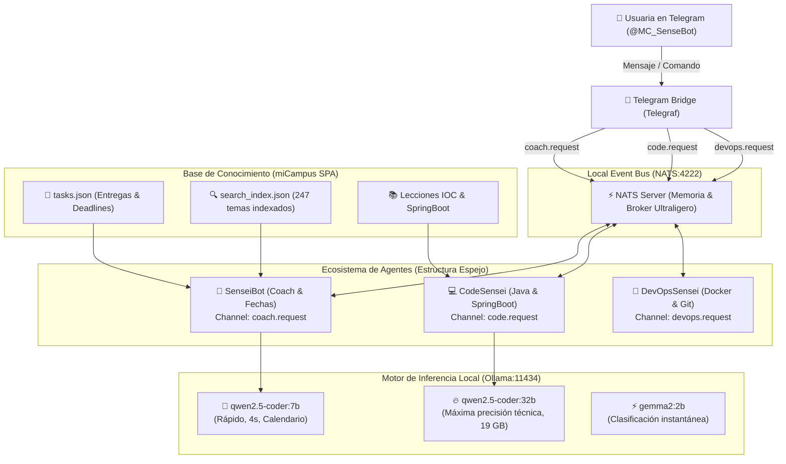

# 🥋 miCampus AI Ecosystem: Arquitectura Multi-Agente Local

Sistema distribuido de agentes de Inteligencia Artificial que operan de forma **100% local, privada y soberana** en un **MacBook Pro M5 Pro (48 GB RAM)**, integrados con la plataforma de estudio **miCampus** y accesibles en tiempo real mediante **Telegram**.

---

## 🧭 Visión del Proyecto
El ecosistema está diseñado como un **equipo de tutores y coaches personales adaptados a perfiles neurodivergentes (TDAH / enfoque visual)**. 
En lugar de depender de una sola IA genérica o de servicios en la nube lentos y con suscripciones de pago, el sistema utiliza:
- **Agentes especialistas** con personalidades y contextos específicos.
- **Micro-mensajería de latencia ultra-baja** mediante el bus NATS.
- **Modelos abiertos de última generación (Ollama)** asignados quirúrgicamente según la tarea.
- **Acceso móvil instantáneo** desde Telegram para recordatorios, preguntas de código y organización diaria.

---

## 🏛️ Diagrama de Arquitectura



---

## 🪞 Estructura "Espejo" de los Agentes

Para garantizar modularidad y mantenibilidad, cada agente sigue una **anatomía estándar ("espejo")**:

```text
src/agents/
├── launcher.js               # 🚀 Orquestador central (arranca todos los procesos)
│
├── coach/                    # 🥋 Agente 1: SenseiBot (Organización & Coaching)
│   ├── index.js              # Worker NATS ('coach.request') + Inyección de tasks.json
│   ├── soul.txt              # Personalidad: empático, conciso, alertas ⚠️, formato DD/MM
│   └── skills/               # Habilidades modulares (reminder.md)
│
├── code/                     # 💻 Agente 2: CodeSensei (Programación & Backend)
│   ├── index.js              # Worker NATS ('code.request') + Temario SpringBoot/Java
│   ├── soul.txt              # Personalidad: depurador paciente, pedagógico, senior dev
│   └── skills/               # Habilidades (debug.md, explain_code.md, test.md)
│
└── devops/                   # 🐳 Agente 3: DevOpsSensei (Docker, Git & Despliegue)
    ├── index.js              # Worker NATS ('devops.request') + Temario ENT/DESP
    ├── soul.txt              # Personalidad: terminal, comandos linux, CI/CD
    └── skills/               # Habilidades (dockerfile.md, git_flow.md)
```

---

## 🧠 Asignación Multimodelo por Agente

Gracias a los **48 GB de memoria unificada del M5 Pro**, cada agente carga el modelo idóneo para su propósito sin comprometer rendimiento:

| Agente | Modelo de Ollama | VRAM Aprox. | Función Clave |
| :--- | :--- | :--- | :--- |
| **SenseiBot** | `qwen2.5-coder:7b` | ~4.7 GB | Responde en 4-5s sobre fechas, entregas con emojis de colores y alertas de coincidencias. |
| **CodeSensei** | `qwen2.5-coder:32b` | ~19 GB | Resolución de algoritmos complejos, patrones de diseño Spring Boot, JUnit y depuración exhaustiva. |
| **Clasificador** | `gemma2:2b` | ~1.6 GB | Clasificación y enrutamiento en menos de 1 segundo. |

La asignación se configura fácilmente mediante variables de entorno en `.env`:
```env
COACH_MODEL=qwen2.5-coder:7b
CODE_MODEL=qwen2.5-coder:32b
OLLAMA_HOST=http://127.0.0.1:11434
NATS_URL=nats://127.0.0.1:4222
```

---

## ⚡ Por qué NATS como Bus de Comunicación
- **Consumo de recursos:** NATS consume menos de **15 MB de RAM**, arrancando en 5 milisegundos.
- **Desacoplamiento total:** Los agentes no se conocen entre sí ni conocen a Telegram; solo escuchan y publican temas (`subjects`).
- **Resiliencia:** Si reinicias un agente o Telegram, el bus se mantiene intacto y los mensajes no se pierden.
- **Escalabilidad:** Si una tarea es pesada, se pueden lanzar múltiples instancias del mismo agente en un grupo de cola (`queue group`) y NATS reparte el trabajo automáticamente.

---

## 🛠️ Comandos de Ejecución

```bash
# 1. Arrancar el servidor NATS (en segundo plano)
nats-server &

# 2. Iniciar todo el ecosistema de agentes y puente de Telegram
npm run agents

# 3. Probar una consulta de forma manual desde el terminal
nats request coach.request "¿Qué entregas tengo la próxima semana?" --timeout=15s
```

---

## 🎙️ PROMPT PARA NOTEBOOK LM (Audio Overview / Podcast)

Copia y pega el siguiente bloque de texto en **Google NotebookLM** junto con este archivo `README.md` para generar un episodio de podcast estilo *Deep Dive*:

```text
[ROL Y FORMATO]
Actuad como los dos locutores del podcast de NotebookLM (un presentador y una presentadora). Vuestro tono debe ser dinámico, fascinante, curioso y profundamente humano. Estáis analizando el proyecto personal de una estudiante de desarrollo de software llamada Blanca, que ha construido en su MacBook Pro un ecosistema de IA local revolucionario.

[FOCOS CLAVE DE LA CONVERSACIÓN]
1. LA HISTORIA Y EL PROPÓSITO:
   - Explicad que Blanca está estudiando un grado de desarrollo web (DAW) y es neurodivergente (TDAH).
   - En lugar de abrumarse con calendarios convencionales o pagar suscripciones a IAs en la nube que olvidan todo o responden con párrafos gigantescos, decidió crearse su propio sistema a medida: "miCampus AI".
   - Destacad la empatía del diseño: respuestas cortas, directas, con códigos de colores por asignatura (morado, verde, naranja), sin decir el año innecesariamente y avisándole si dos entregas coinciden el mismo día para evitar la sobrecarga cognitiva.

2. LA INGENIERÍA DETRÁS DEL TELÓN (¡Hacedlo sonar emocionante!):
   - Cómo aprovecha su MacBook Pro M5 Pro con 48 GB de RAM unificada para correr modelos potentes en local como Qwen 2.5 Coder 32B y 7B mediante Ollama, sin enviar un solo dato a servidores externos.
   - El uso de NATS: Explicad de forma sencilla la metáfora del "sistema nervioso" o "walkie-talkies digitales" ultraligeros de NATS que conectan a todos los agentes en microsegundos sin consumir recursos.
   - La estructura espejo: Cómo cada bot (SenseiBot para el coaching, CodeSensei para Java/SpringBoot, DevOpsSensei para Docker) comparte una arquitectura modular idéntica pero con cerebros de IA diferentes asignados según su especialidad.

3. LA EXPERIENCIA DE USO:
   - Cómo se conecta todo con Telegram: Blanca solo tiene que abrir el chat con @MC_SenseBot desde el móvil para saber en 4 segundos qué le toca estudiar hoy o pedir que le depuren un error de Spring Boot.

4. CONCLUSIÓN Y REFLEXIÓN FINAL:
   - Cerrad reflexionando sobre lo inspirador que es ver cómo la tecnología local y abierta permite a una persona crear una prótesis cognitiva a medida, transformando la neurodivergencia en una ventaja gracias a agentes que se adaptan a su mente y no al revés.
```
